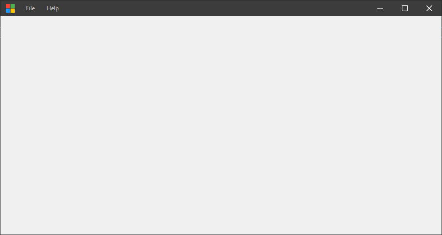
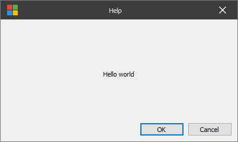

Simplified version frameless Qt window from [qwindowkit](https://github.com/stdware/qwindowkit)

## Changes
1. Use original cmake functions, not [qmsetup](https://github.com/stdware/qmsetup)
1. Add `FramelessWindow` class for main window, `FramelessDialog` for dialog
1. Fix some bugs, e.g. debug output `ReturnHr(21) tid(89a4) 80070057 The parameter is incorrect.`

## Usage

### `FramelessWindow`
```cpp
FramelessWindow w;
w.setWindowIcon(QIcon(":/app/example.png"));
w.setWindowTitle(tr("demo"));
w.resize(960, 600);
w.show();
```


#### Menu bar

Add menus with `FramelessWindow::setMenuBar()`; the menu bar is placed inside
the window bar, next to the window icon:

```cpp
auto bar = new QMenuBar(&w);
bar->addMenu("File");
bar->addMenu("Help");
w.setMenuBar(bar);
```

Note:

- Always call `w.setMenuBar(bar)`. Do **not** use `QMainWindow::setMenuBar()` /
  `QMainWindow::menuBar()` (e.g. from a Qt Designer `setupUi()` file): those
  replace the frameless window bar installed via `QMainWindow::setMenuWidget()`
  and destroy the custom title bar (and crash on Qt 5).
- If the window is too narrow for all menus, the menu bar collapses into its
  built-in overflow button (`qt_menubar_ext_button`, shown as three dots) —
  this is standard `QMenuBar` behavior, not a bug. Give the window enough
  width or a larger `setMinimumWidth()`.

### `FramelessDialog`
```cpp
FramelessDialog dialog;
dialog.setWindowTitle("Dialog");
dialog.setFixedSize(400, 240);
dialog.setCentralWidget(new QLabel("Hello world"));
dialog.exec();
```

